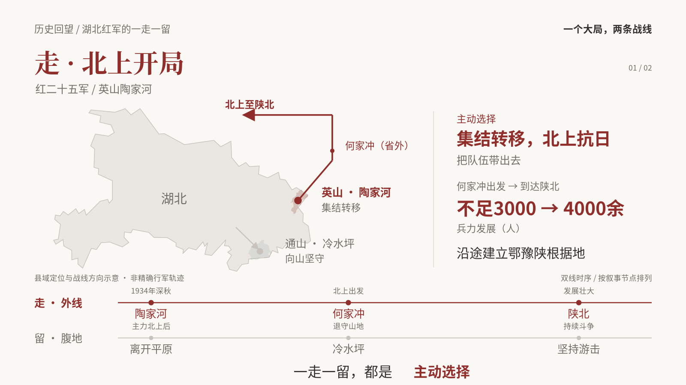
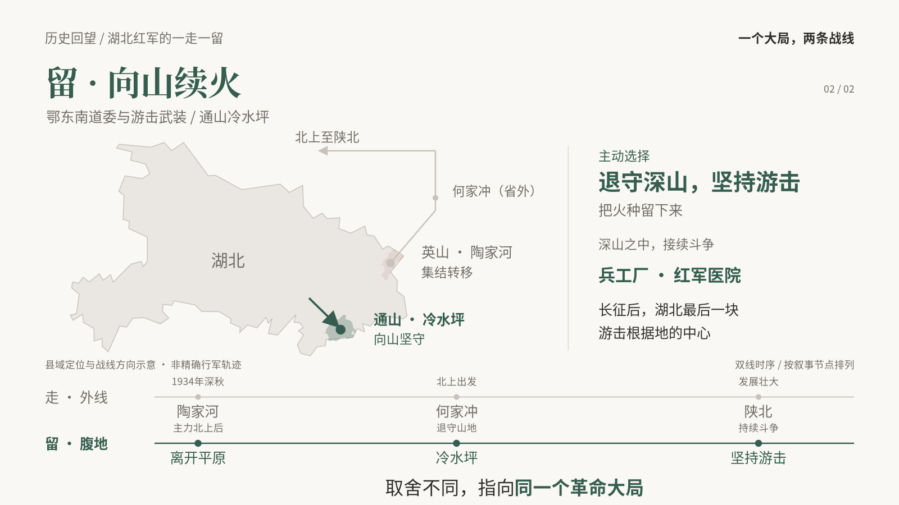

# 一个大局，两条战线

两页对照：**走 · 北上开局**与**留 · 向山续火**。同一张湖北地图、同位双线时序，依次突出两种主动选择，归结到取舍服从大局。

[下载可编辑 PPTX](https://github.com/joyce996/codex-test/raw/refs/heads/main/presentations/walk-stay/walk-stay-two-fronts.pptx) · [查看静态 PDF](preview.pdf) · [查看讲稿](speaker-notes.md)

## 演示方式

建议使用桌面版 Microsoft PowerPoint 的“幻灯片放映”。GitHub 图片、PDF及普通编辑视图只显示完整静态画面。

每页三次点击：

1. 揭示当前战线方向，同时淡入“主动选择”。
2. 淡入结果与证据。
3. 淡入页底结论。

再次点击进入下一页。第二页配置平滑切换，保留湖北标签与两条时序线的对象对应关系。不同办公软件的动画支持可能有差异；文件结构、两页讲稿、8条原生对象动画、3组跨页对象匹配均已检查通过，未在桌面 PowerPoint 中实机播放验证。

## 内容及地图口径

史实文字与兵力数字来自本次提供的叙述；官方史料网页访问受限，尚未独立核验。总括使用“湖北红军”，不将两支队伍归为同一鄂东南组织序列。冷水坪一线保留“主力北上后”等相对时序，不补造年月。

地图依据公开 GeoJSON 勾绘省界及英山、通山两县区域。点位为县域定位，不是精确旧址坐标；箭头表示行动方向，不是考证后的行军轨迹。两条时序线按叙事节点排列，不是等比例时间轴。村址及精确路线可在取得可靠定位资料后进一步细化。

底图数据：[湖北省](https://raw.githubusercontent.com/longwosion/geojson-map-china/master/geometryProvince/42.json)、[黄冈市县域](https://raw.githubusercontent.com/longwosion/geojson-map-china/master/geometryCouties/421100.json)、[咸宁市县域](https://raw.githubusercontent.com/longwosion/geojson-map-china/master/geometryCouties/421200.json)。省界已简化，作为位置示意使用。

## 第一页：走 · 北上开局

## 第二页：留 · 向山续火

